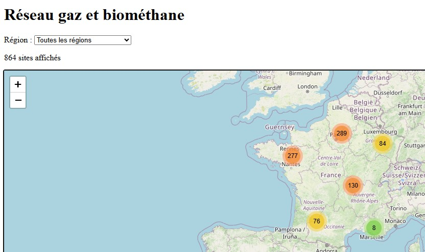
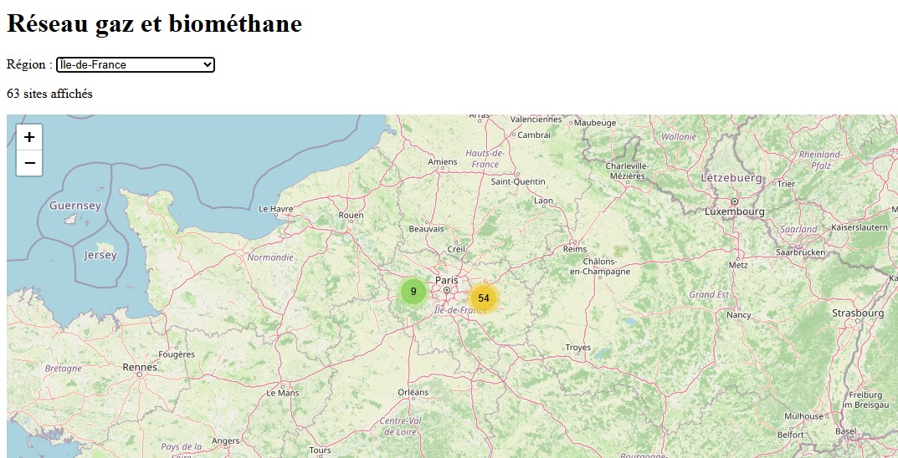

<h1 align="center">Application Webmapping : sites d'injection de biométhane (Leaflet &amp; JavaScript)</h1>

🌐 **Démo en ligne** : [Voir la carte](https://zoubidamechouki.github.io/Application-Webmapping-Reseau-Gaz-Biomethane/)

Ce travail s'inscrit dans le cadre d'un projet personnel de développement d'une application webmapping, visant à visualiser les sites d'injection de biométhane en France sur une carte interactive, à partir de données ouvertes.

*Mots-clés : SIG, webmapping, JavaScript, Leaflet, GeoJSON, open data, API Géo*

Points clés :

- **Carte interactive des sites d'injection** : visualisation de 864 sites de biométhane sur un fond OpenStreetMap, avec popups (projet, commune, capacité) et regroupement des marqueurs.
- **Traitement des données géospatiales** : le fichier source ne contient pas de géométrie, donc les sites sont localisés par jointure sur le code INSEE avec le centre des communes (API Géo).
- **Interface dynamique** : filtre par région, compteur de sites affichés et recadrage automatique de la carte.

## Résumé

🚀 **Fonctionnalités**

- Visualisation de 864 sites d'injection de biométhane sur une carte interactive
- Popups avec le nom du projet, la commune et la capacité de production
- Regroupement dynamique des marqueurs selon le niveau de zoom
- Filtre par région avec compteur et recadrage automatique de la carte
- Localisation automatisée des sites par jointure avec les communes (code INSEE)

🔧 **Technologies utilisées**

- JavaScript (traitement des données, filtre et interactions)
- Leaflet (affichage de la carte interactive)
- Leaflet.markercluster (regroupement des marqueurs)
- GeoJSON (format des données des sites d'injection)
- API Géo (centres des communes pour localiser les sites)
- OpenStreetMap (fond de carte)

  
   
  <strong><em>Figure 1</em></strong><em> – Carte des sites d'injection de biométhane en France</em>

  
   
  <strong><em>Figure 2</em></strong><em> – Filtre par région : Île-de-France</em>

📊 **Sources des données**

- Sites d'injection de biométhane en France : GRDF, NaTran, Terega, SPEGNN, data.gouv.fr, Licence Ouverte 2.0 (mise à jour du 7 octobre 2026)
- Centres des communes : API Géo (geo.api.gouv.fr)
- Fond de carte : © OpenStreetMap contributors

⚠️ **Limite** : les sites sont placés au centre de leur commune, et non à l'emplacement exact de l'installation.

Cette application constitue la première version d'un projet évolutif. Elle pourra être étendue, notamment par un stockage des données dans une base géographique, une API dédiée, des traitements spatiaux (capacité par territoire, proximité) et une automatisation de l'import des mises à jour.